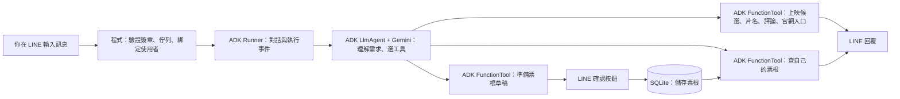

# 電影夥伴 LINE Bot × Google ADK

從新的 LINE 官方帳號開始，做一個能查電影、留下觀影心得、找回共同回憶的電影夥伴。**這個專案的學習與分享主軸是 Google ADK。**

第一版已實作 LINE webhook、ADK agent、六個工具與需要確認的個人票根收藏。尚未部署，新的 LINE 帳號與真實 TMDB 資料需要你填入本機設定後串接測試。

## ADK 實際負責什麼？



- **Gemini**：理解你說的話、提出工具呼叫、整理回覆。
- **ADK**：透過 `LlmAgent`、`FunctionTool`、`InMemoryRunner` 執行工具呼叫與對話流程。
- **一般程式**：確認使用者身分、查資料、驗證欄位、驗證確認按鈕並寫入資料庫。

ADK 的程式集中在 [src/agent.mjs](src/agent.mjs)。LINE 訊息進來會真的呼叫它，沒有使用關鍵字判斷假裝成 AI agent。票根的最終確認採用應用程式的 LINE postback 流程，這部分沒有使用 ADK 內建的工具確認機制。

## 第一版可以做什麼？

| 想做的事 | ADK 工具 | 目前行為 |
| --- | --- | --- |
| 最近可以看什麼？ | `now_playing` | 示範模式回虛構電影；TMDB 模式查台灣上映候選 |
| 這部電影在講什麼？ | `search_movies` | 搜尋片名與繁中簡介，預設不劇透 |
| 有人寫評論嗎？ | `movie_reviews` | TMDB 使用者評論作者與原文連結；不是專業影評總覽 |
| 場次在哪查？ | `showtime_links` | 提供威秀官網入口，尚無即時場次、票價或剩餘座位 |
| 記下跟誰看、心得 | `prepare_ticket` | 建立 10 分鐘有效的草稿，點確認後才存檔 |
| 跟小安看過什麼？ | `list_tickets` | 搜尋自己的最近 200 筆票根，最多顯示 20 筆 |

執行時可看到 `[ADK tool] now_playing` 等訊息，適合拿來觀察與分享工具呼叫。

## 從這裡開始

先裝 **Node.js 24.13 以上**與 **npm 11.8 以上**，然後：

```bash
git clone https://github.com/zonawang/movie-companion-bot-01.git
cd movie-companion-bot-01
npm ci
cp .env.example .env
```

如果之前 Cafe Bot 的 Node/npm 是透過 Codex 提供的臨時路徑啟用，新的終端機不一定找得到，先確認 `node --version`、`npm --version`。

接著照 [建立新的 LINE Bot](docs/line-setup.md) 操作：建立官方帳號 → 啟用 Messaging API → 本機填金鑰 → 啟動 server → HTTPS tunnel → 設定 webhook → 加好友測試。

**不需要先建立 LINE Login 或 LINE MINI App。這一階段建立的是新的 Messaging API Bot。**

### 填哪些設定？

在本機 `.env` 填入：

```dotenv
GEMINI_API_KEY=你的_Gemini_API_key
GEMINI_MODEL=gemini-3.5-flash-lite
LINE_CHANNEL_SECRET=新帳號的_Channel_secret
LINE_CHANNEL_ACCESS_TOKEN=新帳號的_Channel_access_token
MOVIE_DATA_MODE=demo
```

金鑰不要貼在聊天、截圖或提交 GitHub。`.env` 與 `data/` 已加入忽略清單；新 repo 沒有內含任何舊專案金鑰。

### 啟動新 LINE Bot

```bash
npm start
```

開啟 `http://127.0.0.1:3000/health` 應看到 `status: ok`。LINE 需要可對外連線的 HTTPS 網址，不能直接填這個本機網址；請依 [LINE 設定指南](docs/line-setup.md) 建立開發用 tunnel。

### 還沒拿到 LINE 設定，也能先確認程式

```bash
npm test
npm run demo
```

`demo` 是不花 API 額度的**離線工具示範**，不會呼叫 ADK 或 Gemini，不能拿它當作 AI 串接成功的證明。

只填 Gemini key 後，可另外用 `npm run chat` 試同一個 ADK agent，輸入 `/confirm` 確認票根、`/cancel` 取消、`exit` 結束。這是開發輔助入口；產品的主要入口仍然是 LINE。

`npm run smoke:adk` 會真的呼叫 Gemini，驗證查電影 → 建立草稿 → 模擬確認 → 查回票根，會使用 API 額度，測試資料只留在記憶體。

## 用 LINE 試這三句

1. 「最近有什麼電影可以查？」→ 應看到虛構示範電影及工具名稱。
2. 「我 2026-10-25 跟小安看了月台上的貓，心得是配樂很好聽」→ 檢查草稿，點「確認儲存票根」。
3. 「我跟小安看過哪些電影？」→ 應從已儲存票根查回紀錄。

第一次可用示範電影測試；確認後的票根會真的存到你的本機 `data/movie-bot.sqlite`。想改成真實電影資料，依下一節設定。

## 接上真實電影資料

從 [TMDB 帳號 API 設定](https://www.themoviedb.org/settings/api) 取得 API Read Access Token，在 `.env` 設定：

```dotenv
MOVIE_DATA_MODE=tmdb
TMDB_READ_ACCESS_TOKEN=你的_Read_Access_Token
```

重新啟動 server。這裡使用的是 Bearer Read Access Token，請不要把另一種 API key 填進同一欄。

TMDB 的 `now_playing` 與 `region=TW` 是電影上映候選資料，不能保證某間影城今天有場次。評論目前只查繁中使用者評論；空結果會如實說明，不會自動生成影評。即時場次的資料來源尚待確認。

## 學習節奏與後續

從 [第一階段實作與學習紀錄](docs/learning.md) 開始，每次只抓一個 ADK 概念，搭配一個可以觀察的操作。先做一個 agent 能可靠使用工具，再擴充多 agent 或 graph workflow。

目前資料存在本機 SQLite、對話存在 ADK 記憶體 session；重新啟動會清除對話，已確認的票根與未過期草稿仍保留。這版適合單機、小量開發測試，佇列一次處理一個事件；超過 50 秒還沒開始的事件標為過期，請重新傳送。LINE 回覆失敗會記錄狀態，不自動重送已執行過的 AI 任務。

正式部署前再改用持久資料庫、可擴展佇列與權杖管理。若要用 Cloud Run，不能直接依賴容器內的 SQLite 留存票根。評分、海報收藏牆、照片票根、MINI App、專業影評整合與即時場次尚未實作。

## 資料來源與參考

- [Google ADK TypeScript](https://adk.dev/get-started/typescript/) 與 [Function tools](https://adk.dev/tools-custom/function-tools/)
- [LINE Messaging API 開始使用](https://developers.line.biz/en/docs/messaging-api/getting-started/) 與 [驗證 webhook 簽章](https://developers.line.biz/en/docs/messaging-api/verify-webhook-signature/)
- [TMDB 上映候選](https://developer.themoviedb.org/reference/movie-now-playing-list)、[電影搜尋](https://developer.themoviedb.org/reference/search-movie)、[使用者評論](https://developer.themoviedb.org/reference/movie-reviews)
- [TMDB 使用與標示規範](https://developer.themoviedb.org/docs/faq)：接入資料後，對外產品須依規範提供來源與核准標誌；目前沒有顯示海報或 TMDB 標誌。

This product uses the TMDB API but is not endorsed or certified by TMDB.
